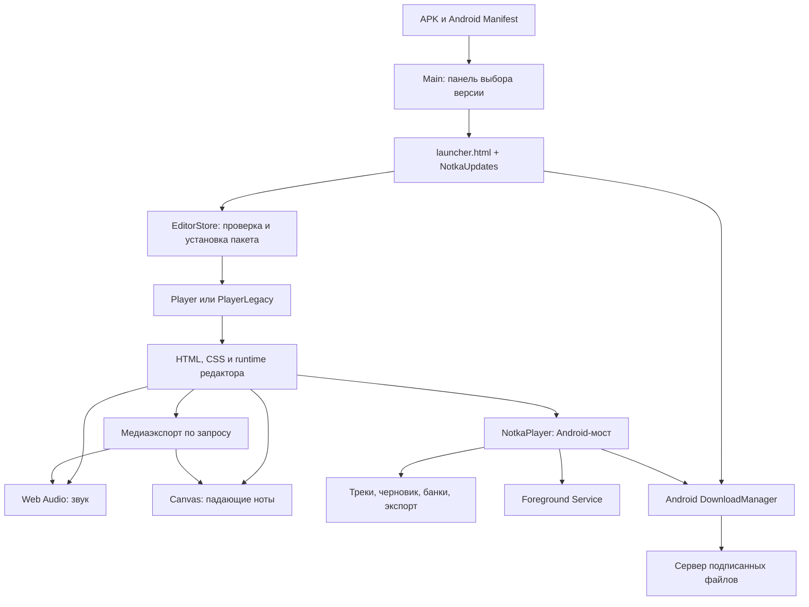

# Устройство Нотки

Карта исходников на 13 ноября 2026. Изменения после исследования: APK 0.70 / редактор 0.83 / панель 0.61, GitHub-канал из ветки `updates`, автоматическая синхронизация версий, запрос каталога при открытии библиотеки, DOM storage в Player и внешние HTTPS-ссылки в браузере. Подробности — [RELEASE-0.70.md](RELEASE-0.70.md).

Базовое исследование: Исследован снимок `f573785f3f67a8fab9755503c25e7a0fa03e46b8`: APK 0.69, редактор 0.82, панель 0.60. Обнаруженные расхождения между этими номерами и фактическим поведением перечислены в [отчёте исследования](RESEARCH-2026-11-13.md). Порядок будущих выпусков — в [руководстве по обновлениям](UPDATES.md).

Нотка — локальный музыкальный редактор Android. Интерфейс и музыкальная логика написаны на JavaScript и работают внутри WebView. Android-оболочка обеспечивает файлы, загрузки, проверку подписей, установку редакторов и время жизни фонового экспорта. В репозитории нет собственного прикладного сервера, аккаунтов или облачной синхронизации треков: удалённая часть раздаёт статические подписанные файлы.

## Общая схема

## Android и точки входа

Это не проект Gradle, Kotlin, React Native или Capacitor. Основная сборка — [source/build.py](../source/build.py).

| Исходник | Назначение |
|---|---|
| `source/host.ops` | 138 методов Android-оболочки; 84 помечены `bridge` и доступны JavaScript. Описывает Main, Player, PlayerLegacy, файловые операции и вызовы Java-помощников. |
| `source/updater_dex.py` | Собственный ассемблер: превращает `host.ops` в `classes.dex`, расставляет ссылки на методы и аннотации JavascriptInterface. |
| `source/native/studio/notka/piano/EditorStore.java` | Хранение, установка, проверка, запуск и удаление редакторов; загрузка отложенных JS-модулей. |
| `ExportRuntime.java`, `ExportTask.java`, `ExportService.java`, `LegacyExportService.java` | Состояние медиаэкспорта, уведомление, отмена, watchdog, удержание процессора. |
| `StorageFiles.java`, `StoragePolicy.java` | Список и удаление управляемых файлов; допустимые имена, категории и адреса APK. |
| `Diagnostics.java`, `DiagnosticExport.java` | Настройки диагностики, отчёт, регистрация падения Java и сохранение отчёта с обратной проверкой файла. |
| `SystemUi.java` | Полноэкранный режим с совместимостью старых Android. |

`build.py` сам создаёт бинарный AndroidManifest.xml, упаковывает ресурсы и подписывает APK схемами JAR/v1 и APK/v2. Java-файлы компилируются ECJ и D8 в `classes2.dex`; AAPT2 собирает значок и таблицу ресурсов. Версии и хеши инструментов закреплены в `source/native-tools.json`.

Пакет приложения — `studio.notka.piano`, `minSdk=21`, `targetSdk=32`. Это заявленные параметры сборки, а не подтверждение работы каждого современного Web API на каждом Android 5. Звук, новые элементы JavaScript и кодировщики зависят также от WebView.

Main загружает панель из `assets/index.html`, включает JavaScript и DOM storage, предоставляет объект `NotkaUpdates`. На Android 9+ Player работает в процессе `:editor` с отдельным каталогом WebView `notka_editor`; на старых Android используется PlayerLegacy в основном процессе. Main передаёт редактору короткий `editionToken`, тему и флаг восстановления. Большой HTML или ZIP через Intent не передаётся.

В Player отключены произвольные file/content-запросы и сетевые загрузки WebView. `EditorStore` обслуживает ресурсы пакета под локальным адресом `https://appassets.androidplatform.net/notka/<token>/`. Это локальный перехватчик, а не внешний сервер. Реальные загрузки выполняются Android DownloadManager через мост.

## Панель выбора версии

[source/app/launcher.html](../source/app/launcher.html) содержит интерфейс, темы, управление загруженными файлами, диагностику и обновления. Это самостоятельная страница внутри APK; установка одного ZIP редактора её не меняет.

Панель объединяет три источника редакторов: исторический встроенный HTML из `bundled-editions.js`, ранее загруженные старые версии в localStorage и проверенные нативные ZIP-пакеты из `EditorStore.inventory()`. Каталоги проверяются в фоне; запуск уже установленной версии не должен ждать сеть.

`NotkaUpdates` предоставляет группы операций:

- APK: `begin`, `status`, `channel`, `hash`, `install`, `discard`, `openPage`, `valid`.
- Редактор: `editionDownload`, `editionText`, `bundleDownload`, `bundleInstall`, `bundleList`, `bundleDelete`, `openEditor`, `resumeEditor`.
- Панель: `setThemeColors`, `storageList`, `storageDelete`, `diagnostics*`, `closePanel`.

Темы и старые HTML-редакторы хранятся в localStorage панели. Цвета передаются выбранному редактору через Intent. В редакторе тему применяет `lifecycle.js`.

## Исходные модули редактора

Порядок задан в [modules.json](../source/app/editor/modules.json). Это **общая лексическая область**, а не независимые ES-модули: функции одного файла обращаются к переменным другого. Перестановка и переименование могут нарушить инициализацию, обработчики HTML или вызовы из Android.

| Модуль в `source/app/editor/` | Ответственность и связи |
|---|---|
| `instruments.js` | Исходные определения инструментов, настройки звука, экземпляры инструментов проекта, дорожки, импорт FrozenPlain. Создаёт `lanes`, `projectInstruments`, `sampleHost`. |
| `diagnostics.js` | Ограниченный локальный журнал, FPS, затраты операций, память звука. Запись включается пользователем. |
| `audio.js` | Декодирование банков, кэш, огибающая, ближайший сэмпл, панорама, фильтр, реверс, голоса. Общая функция — `createInstrumentVoice`. |
| `library.js` | Подписанный каталог, загрузка и удаление банков, поиск, категории, библиотека и настройки экземпляра инструмента. |
| `library-preview.js` | Независимое предпрослушивание, отмена гонок загрузки/декодирования, кэш пяти MP3-примеров, удержание для удаления. |
| `grid.js` | Piano roll, координаты, интервальный индекс нот, виртуализация DOM, выделение, жесты, перемещение, длина, громкость, копирование. |
| `visualizer.js` | Настройки сцены, пресеты, раскладка клавиш, видимые ноты, запуск отрисовки, меню и последовательность действий «Назад». |
| `scene-preview.js` | Звуковой пример и немой просмотр реального трека в настройках сцены; собственные часы и голоса. |
| `transport.js` | Подготовка событий воспроизведения, планировщик Web Audio, старт, остановка, повторение. |
| `player-controls.js` | Пауза, продолжение, перемотка, шкала времени и скрываемая панель проигрывателя. |
| `storage.js` | Формат .notka, миграция старых форматов, проверка импорта, автокопия, именованные файлы, предустановленный Memory. |
| `lifecycle.js` | Темп, применение темы, сворачивание и изменение размеров. |
| `export.js` | MIDI, ZIP со звуком по дорожкам, копия .notka; подключение отдельного медиаэкспортёра. |
| `startup.js` | Завершающая инициализация библиотеки, дорожек, сетки, восстановления и диагностики. |
| `scene-renderer.js` | Отдельный отложенный Canvas-рендерер; использует состояние и функции основного runtime. |
| `shell.html`, `editor.css` | Разметка, идентификаторы элементов, компоновка, темы, портретное и альбомное представление. |

`source/app/index.html` генерируется `build-editor.cjs`: это удобная объединённая версия для разработки и многих тестов. В выпуске используются отдельные файлы из `.native-build/editor/`. Визуализатор и `media-export.js` загружаются по требованию из **того же подписанного пакета**, чтобы не смешивать версии. Для старого HTML-формата медиаэкспорт берётся из APK.

## Данные трека и файловое хранение

Текущий `.notka` — JSON с `format: "notka.track"`, `version: 3`, `ppq: 960`. Это ноты и настройки, без включённых звуковых банков.

- `lanes[]`: имя, `muted`, `ghost`, ссылка `instrumentId`, идентификатор источника `instrument`, массив нот.
- Нота: целочисленные `start`, `len`, `pitch`, `volume`. Редактор принимает MIDI-высоты 24–119 и громкость 0–100.
- `instruments[]`: до 128 экземпляров с `id`, `source`, `name`, `settings`. Несколько дорожек могут использовать один экземпляр. Копирование экземпляра копирует настройки, но не PCM-буферы.
- `scene`: оформление сцены; `activeLane`, `bpm`, `division`, `noteDivision`, `viewDivision`: состояние музыкального проекта и сетки.
- `instrumentSources`: информационные ссылки на источники внешнего звука; импортированный трек не может подменить адрес ссылки приложения.

`readTrack` сначала проверяет и нормализует данные, затем `applyTrack` меняет открытый проект. Поддерживаются версии формата 1 и 2 с миграцией к экземплярам инструментов. Старый редактор не обязательно понимает новый формат сохранений; доступность старого редактора не гарантирует обратимость всех будущих изменений данных.

| Данные | Где и как хранятся |
|---|---|
| Автокопия | Приватный `track-draft.json`, Android AtomicFile; запись раз в 60 секунд при изменениях, дополнительные контрольные записи при уходе в фон и выходе. Это не отдельный черновик для каждой песни. |
| Именованные .notka и экспорт | На Android 10+ MediaStore Downloads, папка `Download/Notka/`; на старых Android app-specific `files/Download/Notka`. |
| Перезапись трека | Приватный журнал `song-write-<id>` до завершения записи публичного документа; на старых Android временный файл и переименование. |
| Банки и данные редактора | Приватные `sound-<имя>.json`; каталог, маркеры незавершённых загрузок, пресеты сцены и предпрослушивания используют тот же ограниченный мост. |
| FrozenPlain | `musicbox-import.json`; временные ZIP/JSON удаляются после проверки или отмены. |
| ZIP-редакторы | `editor-packages/<sha256>/`; временные каталоги не показываются, запущенный пакет удерживает файловую блокировку. |
| Экспорт в процессе | `music-export.part`; только готовый файл переносится в доступную пользователю папку. |
| Диагностика | `diagnostics-*.json`; экспортируется TXT с JSON внутри. |

Удаление приложения очищает приватные данные и app-specific файлы. Для перехода со старого ключа экспорт нужных треков обязателен; не следует считать наличие автокопии резервным копированием.

## Звук и воспроизведение

Движок — сэмплер на Web Audio. Он выбирает ближайшую опорную ноту, транспонирует AudioBuffer, учитывает варианты удара, петлю и параметры экземпляра. Голос проходит через огибающую, необязательный фильтр и панораму; общий выход — gain 0.65 и DynamicsCompressor.

Планировщик в `transport.js` запускается каждые 32 мс, планирует примерно на 120 мс вперёд и ограничивает порцию 512 событиями. Не более 64 живых голосов: при превышении останавливается самый старый. Позиция звука, сцены и шкалы опирается на одни часы AudioContext. Перемотка восстанавливает смещение сэмпла и фазу огибающей, а не просто заново запускает ноту с начала.

Декодированный кэш имеет мягкий бюджет 64 МиБ: используемые дорожками банки сохраняются, поэтому это не абсолютный предел памяти. Реверс хранит дополнительный буфер. Длинные проекты и множество одновременно используемых банков требуют измерений на телефоне.

В APK встроены обычное пианино и Grand Piano MDA. Публичный каталог содержит 36 банков: 30 GeneralUser GS и 6 прежних. FrozenPlain импортируется отдельно из пакета автора; старый публичный Music Box сохранён для совместимости, но скрыт из нового списка. В интерфейсе редактора 0.82 предусмотрено 37 видимых позиций.

Банк — `notka.instrument.1`: метаданные, опорные высоты, настройка, петли и base64-аудио. GeneralUser адаптирован в 7 опорных записей на инструмент, PCM mono 32 кГц/16 бит. Это не воспроизведение произвольного SF2 в приложении. `build_generaluser.py` использует внешний закреплённый SF2, FluidSynth, NumPy, SciPy и FFmpeg; обычная сборка APK использует уже подготовленные банки и этих инструментов не требует.

## Экспорт

| Путь | Что создаёт |
|---|---|
| `exportMusic('notka')` | Полный редактируемый проект с версией редактора в имени; не переключает текущий рабочий файл. |
| `makeMidi` | MIDI Type 1, темп, отдельные дорожки, GM program, громкость, панорама, транспонирование; до 15 непустых дорожек, канал ударных пропущен. |
| ZIP из `export.js` | `Original.notka`, `Track.mid`, `Tracks.json`, `Mix.wav`, отдельные `Tracks/*.wav`, пояснение. WAV stereo 32 кГц/16 бит. |
| `app/media-export.js` | WAV, M4A/AAC, WebM/Opus, OGG/Opus, MP4/H.264, WebM/VP8 — только форматы, поддерживаемые кодировщиками устройства. |

Параметры сэмплера не полностью переносятся через MIDI. Огибающая, фильтр, реверс, обрезка и точная подстройка остаются в .notka и запекаются в WAV.

Оба пути рендера используют `createInstrumentVoice` и OfflineAudioContext, окна по 8 секунд с прогревом до 1 секунды. Выход пишется порциями, лимит — 256 МиБ. Медиаэкспорт использует Mediabunny и запись с произвольной позицией для индексов контейнера. Его foreground service поддерживает уведомление и отмену, но **не продолжает работу после уничтожения процесса**. `ExportTask` имеет предел 6 часов и watchdog по отсутствию heartbeat 5 минут. Экспорт MIDI/ZIP из обычного меню не использует этот же foreground-протокол.

## Подписи и обновляемые форматы

Серверные JSON имеют конверт `{record, signature}`. `record` — строка, подписываются её точные UTF-8 байты RSA/SHA-256. Переформатирование JSON внутри `record` ломает подпись.

| Файл | Контракт |
|---|---|
| `dist/channel.json` | Код и версия APK, SHA-256 в base64, сведения о панели. |
| `dist/editions/<code>.json` | Старый HTML/base64-редактор `notka.editor.1`, предел body 190000 символов. |
| `dist/bundles/catalog.json` | Каталог `notka.catalog.1`, объединяющий историю и новые ZIP-пакеты. |
| `dist/bundles/<code>.zip` | Подписанный `manifest.json` типа `notka.bundle.1`, версия, `minApk`, точный список файлов, размеры, hex SHA-256. |
| `dist/soundbank/catalog.json` | `notka.instruments.1`, стабильные ID/asset/revision, размеры, base64 SHA-256 и необязательное preview. |
| `dist/soundbank/bank-*.json` | Подписанный инструмент. |
| `dist/soundbank/preview-*.json` | Подписанный короткий MP3 `notka.preview.1`. |

ZIP: архив до 8 МиБ, отдельный файл до 8 МиБ, суммарно до 24 МиБ, не более 64 файлов содержимого. Установка проверяет подпись и хеши до атомарного переименования. Разрешены плоские имена HTML/JS/CSS/TXT. Текущие наборы содержат 6 файлов содержимого плюс манифест.

Новый закрытый ключ находится вне репозитория, в `D:\Tools\Notka\keys\signing.pem`; его сертификат — `source/signing.der`. `source/signing-legacy.der` позволяет проверять старые материалы, но не подписывать новые старым ключом. Старый установленный APK автоматически не получает доверие к новому сертификату. Смена ключа уже потребовала согласованной переустановки; следующие выпуски должны сохранять нынешнюю идентичность.

## Где искать изменение

| Задача | Начать здесь | Затрагиваемые проверки |
|---|---|---|
| Ноты, сетка, жесты | `grid.js`, `editor.css`, `shell.html` | editor6, selection, overlap, double-tap, copy-notes, performance |
| Дорожки и параметры инструмента | `instruments.js`, `library.js`, `storage.js` | channel-panel, rack, instruments, tracks, background-selection |
| Звучание и перемотка | `audio.js`, `transport.js`, `player-controls.js` | seek, loop, player-hud, player-optimization; реальное Web Audio |
| Вид проигрывателя | `visualizer.js`, `scene-renderer.js`, `scene-preview.js` | scene, scene-preview, scene-presets, track-scene |
| Файлы и восстановление | `storage.js`, соответствующие методы `host.ops` | tracks, autosave, back, export-files; системный выбор файлов на телефоне |
| Аудио и видео | `export.js`, `media-export.js`, Java Export* | export, media-export, background-service; реальные кодировщики |
| Обновления | launcher, EditorStore, host.ops, издательские скрипты | launcher, update, bundle-panel, bundles, signing, update-origin |
| Новый звук | Генератор банка, каталог, `library.js` | catalog, library-preview, soundbank81; прослушивание |

Исторические `APK-*.md`, `EDITOR-*.md`, `migration-tools/`, `PERSONAL-BUILD-48.md` объясняют происхождение решений. Их номера, пути `/workspace/sites/...` и политика публикации не должны заменять нынешние инструкции. Приоритет имеют корневой `AGENTS.md`, текущий код и документы исследования.
