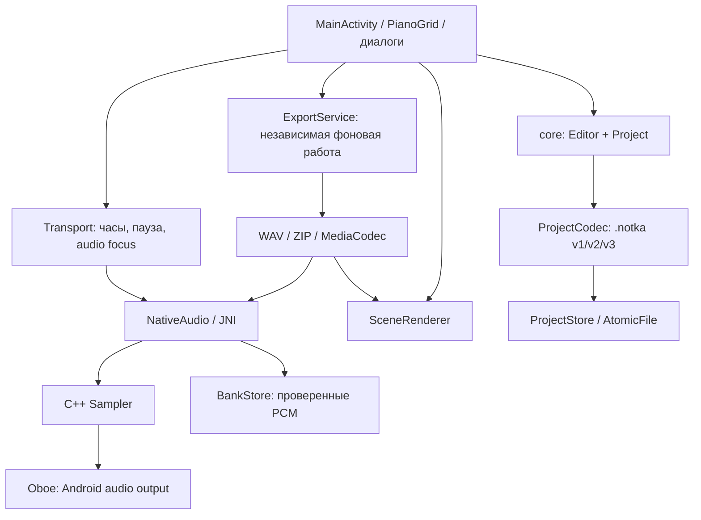

# Устройство Нотки 2

Нативное приложение Android, пакет `studio.notka.next`. Данные и ключ независимы от Нотки 0.70. Прикладного сервера, регистрации и облачного хранения нет. Сеть нужна для каталога звуков, примеров, банков и обновления APK.

## Границы модулей

`core/src/main/kotlin/studio/notka/core/` — чистый Kotlin/JVM:

- `Project.kt`: неизменяемые ноты, дорожки, стойка, настройки звука и сцены; PPQ 960, высоты 24–119. Старые алиасы инструментов приводятся к стабильным ID.
- `ProjectCodec.kt`: импорт v1/v2/v3 и экспорт v3, предел файла 16 МиБ, проверка всего проекта до изменения редактора. Адреса из `instrumentSources` не становятся адресами загрузки.
- `Editor.kt`: команды, одна завершённая операция/жест — одна запись истории; 80 состояний undo. Общие настройки инструмента принадлежат экземпляру стойки, а не дорожке.
- `NoteIndex` в `Editor.kt`: индекс по высоте и времени, с максимальным концом для длинных нот. Используется сеткой и сценой.
- `Midi.kt`: SMF Type 1, PPQ 960, темп, program/CC, до 15 музыкальных каналов без percussion channel 10.
- `Wave.kt`: ограниченный декодер RIFF PCM и заголовки WAV.

## Интерфейс и потоки

`app/src/main/java/studio/notka/next/`:

- `NotkaApplication` хранит редактор, состояние готовности и очереди. Изменения Editor выполняются в главном потоке. `worker` готовит звук и операции проекта; `io` последовательно пишет автокопии; `network` не задерживает подготовку звука при медленном интернете.
- `MainActivity` связывает сценарии. `ui/PianoGrid` рисует только видимую область Canvas. Во время жеста меняется предварительное изображение; окончательные ноты записываются при отпускании.
- `ui/LibrarySheet`, `SceneSheet`, `ExportSheet` — библиотека, настройки сцены и экспорт. Формы проверяют значения перед применением.
- `ui/SceneRenderer` общий для экрана, предпросмотра и видео. Настройки старого поля `quality` сохраняются в проекте; нативный экран рисуется в физическом разрешении, разрешение видео задаётся отдельно. Графика реализована заново: это не побитовое воспроизведение старого Canvas/WebView.
- `audio/Transport` владеет живым движком, аудиофокусом, паузой и перемоткой. При сворачивании обычное проигрывание останавливается; экспорт продолжает работать. Токены поколений закрывают устаревшие результаты подготовки.

## Звук

`app/src/main/cpp/sampler.*` — общий офлайн/живой стереосэмплер. Сэмплы и события готовятся до запуска. До 64 голосов; при переполнении вытесняется самый старый. Есть ближайшая опорная нота, tune, варианты удара, исходная петля, обрезка, реверс, ADSHR, velocity, транспонирование, панорама, biquad-фильтр и ограничитель амплитуды. События назначаются по номеру сэмпла, а не таймеру интерфейса. Цикл определяется музыкальным концом трека; хвосты голосов продолжаются через границу.

`bridge.cpp` выводит Float stereo через Oboe. Частота живого звука — 48 кГц; Oboe при необходимости преобразует её к устройству. Изменения движка выполняются с закрытым потоком. В callback нет файлов, JNI, блокировок и выделений памяти. `NativeAudio` синхронизирует владение native handle; каждый экспорт и предпрослушивание получают отдельный движок. Общий кэш BankStore хранит неизменяемый PCM.

Перемотка восстанавливает позицию сэмпла и огибающую активных нот. История фильтра после перемотки начинается заново, как и при создании голоса в прежней реализации. Реальная задержка и пропуски звука зависят от телефона; успешный рендер WAV не измеряет задержку динамика.

## Файлы и доверие

- `data/Files.kt`: AtomicFile для проектов и автокопии; имена не допускают пути. Испорченный черновик сохраняется отдельно в recovery. Импорт не заменяет проект до успешной проверки и подтверждения открытия.
- `data/BankStore.kt`: закреплённые сертификаты, SHA-256, проверка подписи каждого банка и примера, атомарная установка. Каталог не может заменить уже известный asset новым содержимым. Кэш декодированных банков ограничен 64 МиБ, подготовленный проект — 128 МиБ PCM; примеров — пять.
- Примеры старых банков — подписанный JSON с MP3 внутри, а не открытый MP3 по каталожному URL. Сначала проверяются размер, хеш и подпись, затем извлекается аудио.
- `data/FloeImporter.kt`: только исходный Music Box Suite Free с закреплённым хешем и ожидаемыми 31 записями. Личные записи и лицензия остаются в приватных данных приложения. В APK они отсутствуют.
- `data/UpdateManager.kt`: только отдельный native channel и собственный сертификат. До установки проверяются подпись канала, размер/хеш, package, версия и сертификат APK. `UpdateFileProvider` выдаёт только чтение конкретного APK установщику.
- `data/Diagnostics.kt`: выключенный по умолчанию ограниченный локальный журнал. Не записывает ноты, аудио и тексты исключений; отчёт содержит устройство, версию, стек ошибок, счётчики пропусков вывода (если драйвер их предоставляет) и вытеснения голосов. Ничего не отправляется автоматически.

## Экспорт

`ExportService` получает короткий идентификатор приватного файла задания; большой проект не передаётся через Intent. Служба foreground с уведомлением и отменой, wake lock, ограничением времени и остановкой при отсутствии прогресса. Android 15 использует тип mediaProcessing; на прежних версиях — dataSync/обычный foreground.

`AudioExport` пишет WAV потоково, ZIP содержит исходный .notka, MIDI, общий WAV, отдельные дорожки и метаданные. Дорожки выровнены по началу и длине. `CodecExport` использует MediaCodec/MediaMuxer: AAC/M4A, Opus/OGG/WebM, AVC/MP4 и VP8/WebM по доступности устройства. Видео рисуется общим SceneRenderer в EGL surface кодировщика. Размер результата ограничен 256 МиБ; ошибки кодировщика не выдаются за успех.

Сначала пишется временный локальный результат, затем выбранный через Android файл. Успех показывается только после завершения записи. Принудительное уничтожение процесса прерывает экспорт; автоматического возобновления нет. Обычное сворачивание Activity не уничтожает работу службы.

## Обновления

Код, интерфейс и встроенные звуки обновляются APK целиком; отдельные HTML/ZIP-редакторы больше не используются. Это убирает смешивание версий оболочки и редактора.

- Новая разработка: `main`, папка `next/`.
- Новый активный канал: `native-updates/next/dist/channel.json`.
- Новый каталог: `native-updates/next/dist/soundbank/catalog.json`.
- Исторические банки с `origin: legacy` (по умолчанию) скачиваются из неизменяемого тега `legacy-final-0.70/dist/soundbank/`.
- Новые банки получают `origin: native`, новые asset/revision и размещаются в `next/dist/soundbank/`. Каталог может обновляться без APK.
- Прежние `updates`, `dist/` и Site не переключаются новым публикатором.
